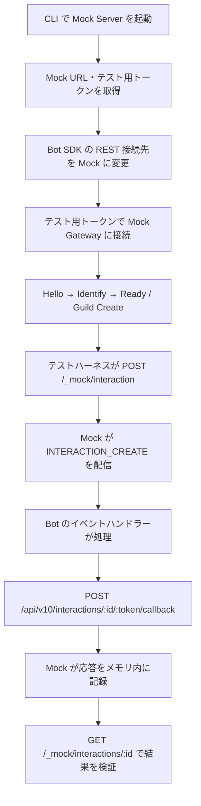

# discord-mock

**discord-mock** は、Discord Bot を自分の PC または自分で管理する VPS 上で手動・自動テストするための、セルフホスト型 Mock 環境です。**SaaS として公開・提供しません。** 本番の Discord API・認証情報を使用せず、ローカルで生成したダミーデータとテスト用トークンを扱います。

> [!IMPORTANT]
> **現在は開発途中です。** REST / Gateway の基本接続、メッセージ操作の一部、テスト用 Interaction とその応答記録を実装しています。一方、`/test` と `/admin` は **プレビュー画面**で、ダミーユーザーのログイン・管理 UI、DM、実際に聴ける VC 音声などはまだ利用できません。全 Discord API との互換性を保証するものでもありません。

## アーキテクチャ

### Monorepo の構成

| ディレクトリ | 言語 | 役割 |
| --- | --- | --- |
| `apps/web/` | TypeScript | ブラウザで開くテスト画面・管理画面。**現段階はサーバーに組み込まれた静的プレビュー** |
| `apps/server/` | TypeScript | CLI、HTTP REST、Gateway WebSocket、Mock 状態管理、JSON 保存 |
| `packages/client-js/` | TypeScript | 既存 `discord.js Client` / `SapphireClient` のインスタンス・継承アダプター |
| `packages/client-py/` | Python | 既存 `discord.Client` / `commands.Bot` のインスタンス・継承アダプター |
| `spec/` | YAML / Markdown | 共通 API 仕様・対応範囲の記録 |
| `tests/` | テストごと | 横断テストの構成・方針 |
| `.github/workflows/` | YAML | Web・JS・Python の CI と、既定では無効の npm / PyPI 公開ワークフロー |

ルートの [`AGENTS.md`](AGENTS.md) に共通ルールを置き、各ディレクトリの `AGENTS.md` に言語・機能固有のルールを定義しています。

### コンポーネントの関係


- **Web 画面は別ポートの Web サーバーとしては起動しません。** 現在は `apps/server` が TypeScript で定義された HTML プレビューを返します。
- Mock Server は既定で `127.0.0.1:3000` に待ち受けます。Bot 側の REST / Gateway 接続先も Mock を指定します。
- JSON の永続化は `DISCORD_MOCK_STATE_PATH` 指定時のみ有効で、現状は主にメッセージ更新の保存に対応しています。Interaction の応答など、すべてのランタイム状態が永続化されるわけではありません。
- Voice Gateway・UDP / RTP による実際の音声通信は未実装です。

### テスト実行フロー（Mermaid）

以下は **現在実装している最小限の Interaction 経路**です。管理 API を使ってダミーユーザーの操作イベントを生成し、Bot が返したコールバック応答を確認します。ブラウザ上でコマンドを選択・実行する UI はまだありません。



この例で `/_mock/...` は **discord-mock 独自のテスト管理 API** であり、Discord 公式 API のエンドポイントではありません。テスト管理 API には、CLI が起動時に表示する `x-discord-mock-secret` が必要です。

## サンプル Bot を使った動作テスト

[`examples/dev-container-ts-bot/`](examples/dev-container-ts-bot/MOCK-TEST.md) に、別リポジトリ [`furimu1234/dev_container_ts_bot`](https://github.com/furimu1234/dev_container_ts_bot) の **Bot + DB の2パッケージからなる TypeScript モノレポ** を取り込みました。元の `packages/bot/src` と `packages/db/src` の構成・実際のレベリングイベントおよび Drizzle の DB 関数を保持し、Node.js / pnpm の互換性と既知のエラーだけ修正しています。

```sh
pnpm install
pnpm build
pnpm sample:test
```

`sample:test` は新しいテンプレート Bot が対象です。テスト内で Mock Server を起動し、実際の discord.js `Client` を接続して `MESSAGE_CREATE` を送信、元の `leveling.ts` と `@ex/db` の関数が呼ばれてレベルが更新されることを検証します。**テスト中に PostgreSQL の実サーバー・本番 Discord トークンは必要ありません。** DB 部分はテスト専用のインメモリアダプターです。

移植元の `src/main.ts` は未完成の実 DB / Discord 接続部分があるため、Mock 用に `src/mock.ts` を追加してそこから実際のイベント・DB 関数を使用します。移植元は `/ping` コマンドを持っていないため、以前の簡易サンプルの `/ping` ではなく、移植元のメッセージ・レベリングを検証します。前の最小サンプルは `examples/sample-bot/` に残していますが、`sample:test` の実行対象ではありません。

詳細な変更点・手動起動方法は [移植版のガイド](examples/dev-container-ts-bot/MOCK-TEST.md) を参照してください。

## 開発者向け：初期セットアップ

### 共通の前提

- 対応 OS: **Windows / Ubuntu・その他の Linux / macOS / NixOS**。ただし NixOS 固有の設定は下記 `nix-shell` を使用します。
- Node.js **24.17.0 以上**、pnpm **11 系**。TypeScript、esbuild などは `pnpm install` でプロジェクト内に入ります。
- Python クライアントを開発・テストする場合は Python **3.11 以上**と **uv** が必要です。
- **依存インストールとビルドは手動**です。シェルに入るだけ・`pnpm dev` を実行するだけでは、自動で `pnpm install` や `pnpm build` は走りません。

#### NixOS（推奨：`nix-shell`）

このリポジトリの開発環境は次の NixOS で構築しています。

```json
{
  "nixosVersion": "26.05.12658.1f607aa79b63",
  "nixpkgsRevision": "1f607aa79b6356ed45d3cd3c8079c196e79efa2c"
}
```

[`shell.nix`](shell.nix) に Node.js 24、pnpm 11、Python 3.13、uv を定義しています。ホストの `<nixpkgs>` を使用するため、上記 nixpkgs リビジョンの**固定（pinning）はしていません**。

```sh
git clone https://github.com/furimu1234/discord-mock.git
cd discord-mock
nix-shell

# ここから先は nix-shell 内。各コマンドが自動的に PATH で利用可能
node --version
pnpm --version
python3 --version
uv --version

# 初回セットアップ（手動）
pnpm install
uv sync --project packages/client-py

# 必要なときに手動ビルド
pnpm build
```

`nix-shell` の外ではこれらのツールをシステム全体へ追加しません。`configuration.nix` や `environment.systemPackages` は変更不要です。`exit` でシェルを抜けるとツールの PATH 設定は元に戻ります。依存インストール済みの `node_modules` / `.venv` は、シェルを抜けても作業ディレクトリに残ります。

`shell.nix` は uv に Nix 提供の Python を使わせ、一般 Linux 用 Python を自動ダウンロードさせないよう設定します。NixOS では **`corepack enable` は不要**です。

#### Windows / Ubuntu / macOS（Nix を使わない場合）

最初に Node.js 24.17+ を導入します。**Corepack がない Node.js 環境では Corepack も別途導入**してください。PowerShell、bash、zsh など各 OS のターミナルから実行できます。

```sh
git clone https://github.com/furimu1234/discord-mock.git
cd discord-mock

# Corepack がインストール済みなら pnpm の起動を有効化
corepack enable

# 依存のインストール（手動）
corepack pnpm install

# ビルド（手動）
corepack pnpm build
```

Corepack を使用しない場合は、別途 pnpm 11 を用意し、`pnpm install` と `pnpm build` を実行します。Python 側を開発する場合は uv をインストールした後に `uv sync --project packages/client-py` を実行します。

> サンプル Bot の移植が未マージの場合は、対応する PR の作業ブランチをチェックアウトしてからビルドしてください。

### VS Code のターミナル（NixOS / Linux）

このリポジトリには [`.vscode/settings.json`](.vscode/settings.json) を用意しています。**Linux の VS Code でこのフォルダーをワークスペースとして開くと、新しい統合ターミナルは `nix-shell` から起動します。** ターミナルを開くたびに手動で `nix-shell` と入力する必要はありません。

`shell.nix` の pnpm への不要な `nodejs` override を廃止し、`evaluation warning: pnpm: Override nodejs-slim instead of nodejs` を解消しています。起動ごとの案内文も表示しません。VS Code 以外の通常のターミナルでは従来どおり `nix-shell` を実行します。

NixOS 以外の Linux で Nix が入っていない場合は、VS Code のターミナルプロファイルを手動で別のものに切り替えてください。Windows・macOS のターミナル設定は変更しません。

### 開発サーバーの起動と停止

初回は上記の `pnpm install` と `pnpm build` を済ませてください。

```sh
# リポジトリ直下（NixOS では nix-shell 内）
pnpm dev

# 別ポートで起動したい場合
pnpm --filter @discord-mock/server dev -- --port 3001
```

起動すると、CLI に Web URL と Mock 用のトークン・管理用シークレットが表示されます。

| URL（既定のポート 3000） | 用途 |
| --- | --- |
| `http://127.0.0.1:3000/test` | テスト画面（現時点ではプレビュー） |
| `http://127.0.0.1:3000/admin` | 管理画面（現時点ではプレビュー） |
| `http://127.0.0.1:3000/health` | ヘルスチェック |
| `http://127.0.0.1:3000/api/v10/...` | 対応済みの Mock REST API |
| `ws://127.0.0.1:3000/gateway` | Mock Gateway WebSocket |

**`pnpm dev` はビルド済みファイルを起動するだけ**です。TypeScript を編集した場合は `pnpm build` を実行し、サーバーを再起動してください。停止する場合はターミナルで `Ctrl+C` を押します。

### テスト・型チェック

ビルド済みの状態から以下を実行できます。

```sh
pnpm test
pnpm --filter @discord-mock/server typecheck
pnpm --filter @discord-mock/client-js typecheck
uv run --project packages/client-py ruff check packages/client-py
uv run --project packages/client-py pytest packages/client-py/tests
```

`pnpm test` は Web・Server・JavaScript クライアントのテストを実行し、Python のテストは uv で別途実行します。テストを実行してもビルドは自動実行されません。

## 一般ユーザー向け：ビルド済み Mock の起動

**一般ユーザーが Mock サーバーを起動するだけなら pnpm / Corepack / uv / TypeScript は不要です。** ただし **Node.js 24 以上（プロジェクトの最低要件は 24.17.0）** は必要です。

### 1. ビルド済みファイルを用意する

開発者が `pnpm build` すると、Mock サーバーの起動用ファイル **`apps/server/dist/discord-mock.cjs`** が生成されます。このファイルは、必要な JavaScript 依存関係をまとめた配布用の Node.js スクリプトです。

一般ユーザーは、**開発者から受け取った `discord-mock.cjs`** を任意のフォルダーに置いてください。単一の JS ファイルなので、実行時は pnpm のワークスペースや `node_modules` は不要です。

> 現時点で GitHub Releases から自動的にビルド済み配布物をダウンロードできるワークフローは**未整備**です。GitHub のソースコードだけをクローンしても、`dist/` は生成されません。ソースから実行する場合は「開発者向け」の手動ビルド手順が必要です。

### 2. 起動する

Windows の PowerShell、macOS / Ubuntu / 一般 Linux のターミナルで、ファイルを配置したフォルダーから実行します。

```sh
node discord-mock.cjs
```

既定ではポート 3000 を使用します。変更する場合:

```sh
node discord-mock.cjs --port 3001
```

NixOS で Node.js をシステムに恒久的にインストールせず実行したい場合は、Nix CLI が利用できる環境で以下のようにします。

```sh
nix shell nixpkgs#nodejs_24 -c node discord-mock.cjs
```

これは **Node.js で JS ファイルを起動する方式**であり、OS ごとの単体ネイティブ実行ファイル（`.exe` など）の配布ではありません。

### 3. ブラウザで開く・終了する

CLI に表示された URL をブラウザで開きます。既定では `http://127.0.0.1:3000/test`（テスト画面）と `http://127.0.0.1:3000/admin`（管理画面）です。現段階ではどちらも機能実装前のプレビューです。終了は起動ターミナルの `Ctrl+C` です。

Mock の API に Bot を接続する際は、CLI に表示された **`mock_` で始まるテスト用トークン**だけを使用し、Discord 本番の Bot トークンは使用しないでください。管理用シークレットも第三者に共有しないでください。

### データを JSON に保存したい場合

保存先を指定しなければメッセージ等の状態は基本的にメモリ上に保持され、再起動時に初期化されます。JSON 保存先を指定すると、対応済みの状態更新が保存されます。

macOS / Linux / NixOS（bash / zsh）:

```sh
DISCORD_MOCK_STATE_PATH=./mock-data.json node discord-mock.cjs
```

Windows PowerShell:

```powershell
$env:DISCORD_MOCK_STATE_PATH = ".\mock-data.json"
node .\discord-mock.cjs
```

`mock-data.json` などの実行時データにはテストで使用した情報が含まれる可能性があります。Git にコミットせず、安全な場所に保存してください。

## Bot SDK の接続例

JavaScript の `discord.js` / Sapphire は、[`packages/client-js/README.md`](packages/client-js/README.md) にある `disMockClient(client)` または `disMockMixin(MyBot)` を使用します。Mock の `/api` に REST 接続先を変更し、実 SDK での基本 Gateway 接続を検証しています。

Python の `discord.py` / `commands.Bot` は、[`packages/client-py/README.md`](packages/client-py/README.md) にある `disMockClient(client)` / `DisMockMixin` を使用します。REST 接続先の変更は SDK 内部実装である `discord.http.Route.BASE` に依存するため、**バージョン依存・同一プロセスの他の Discord Client と併用不可**です。Python の Gateway 接続の完全な統合検証は未完了です。

どちらも、実 Discord に意図せず接続しないよう、テスト環境からの外向き Discord 通信を遮断することを推奨します。

## セキュリティと今後の実装

- サーバーは**ループバックアドレスのみ**で待ち受けます。VPS では SSH ポートフォワーディングや自分で管理する VPN を利用してください。公衆インターネットへ直接公開しないでください。
- **実装済み（部分対応）:** REST による Gateway 情報取得・Guild / Channel / Message、Gateway の Hello / Identify / Ready / Heartbeat / Guild Create、ダミー Interaction の発行・コールバック保存。
- **未実装または未検証:** ダミーユーザーログイン UI、管理 UI の CRUD、DM、細かなロール・権限判定、完全な Slash Command / Button / Select Menu、Sapphire Piece の一連の動作、全 Discord API・Gateway の互換性、VC の Voice Gateway / UDP / RTP・ブラウザで聴ける音声。
- npm / PyPI のクライアント公開は別々に管理しますが、**現時点の公開ワークフローは無効**です。
- Discord 公式の**公開 API 仕様**を参照した独自実装を前提とし、非公開 API のリバースエンジニアリングは行いません。OSS 配布の規約確認については [`AGENTS.md`](AGENTS.md) を参照してください。
