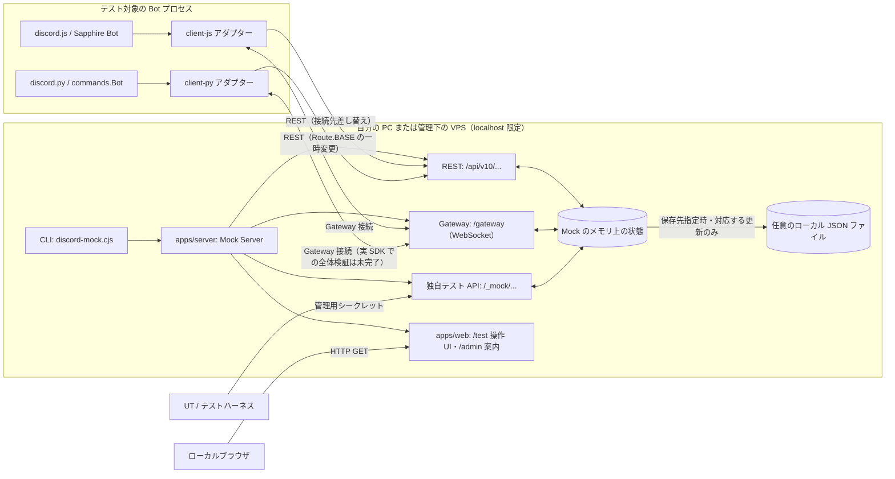
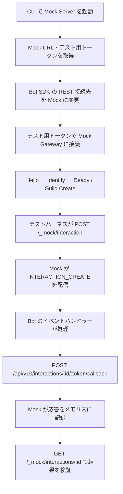

# discord-mock

**discord-mock** は、Discord Bot を自分の PC または自分で管理する VPS 上で手動・自動テストするための、セルフホスト型 Mock 環境です。**SaaS として公開・提供しません。** 本番の Discord API・認証情報を使用せず、ローカルで生成したダミーデータとテスト用トークンを扱います。

> [!IMPORTANT]
> **現在は開発途中です。** REST / Gateway の基本接続、メッセージ操作の一部、テスト用 Interaction とその応答記録を実装しています。`/test` は **操作可能なテスト画面**になり、ダミーユーザーの切り替え、テキスト投稿、Slash Command 発火、Bot 投稿のリアルタイム同期を行えます。`/admin` はまだ簡易案内画面で、管理 CRUD・DM・実際に聴ける VC 音声などは未実装です。全 Discord API との互換性を保証するものでもありません。

## アーキテクチャ

### Monorepo の構成

| ディレクトリ | 言語 | 役割 |
| --- | --- | --- |
| `apps/web/` | TypeScript | ブラウザで開くテスト画面・管理画面。ローカル Bot テスト画面（投稿・ユーザー切替・SSE 更新）と管理画面案内 |
| `apps/server/` | TypeScript | CLI、HTTP REST、Gateway WebSocket、Mock 状態管理、JSON 保存 |
| `packages/client-js/` | TypeScript | 既存 `discord.js Client` / `SapphireClient` のインスタンス・継承アダプター |
| `packages/client-py/` | Python | 既存 `discord.Client` / `commands.Bot` のインスタンス・継承アダプター |
| `spec/` | YAML / Markdown | 共通 API 仕様・対応範囲の記録 |
| `tests/` | テストごと | 横断テストの構成・方針 |
| `.github/workflows/` | YAML | Web・JS・Python の CI と、既定では無効の npm / PyPI 公開ワークフロー |

ルートの [`AGENTS.md`](AGENTS.md) に共通ルールを置き、各ディレクトリの `AGENTS.md` に言語・機能固有のルールを定義しています。

### コンポーネントの関係



- **Web 画面は別ポートの Web サーバーとしては起動しません。** 現在は `apps/server` が TypeScript で定義されたローカル HTML と同一オリジンの JavaScript を返します。
- Mock Server は既定で `127.0.0.1:3000` に待ち受けます。Bot 側の REST / Gateway 接続先も Mock を指定します。
- JSON の永続化は `DISCORD_MOCK_STATE_PATH` 指定時のみ有効です。ユーザー・チャンネル・ロール・メンバーの所属ロール・メッセージ・登録コマンドを保存できます。Interaction の応答済み状態やブラウザセッションはメモリ上で管理します。
- Voice Gateway・UDP / RTP による実際の音声通信は未実装です。

### ソースコードの読み方

`apps/server/src/server.ts` は起動・終了とルーティングを担当します。各処理は次のファイルに分かれています。

| ファイル（`apps/server/src/` 内） | 責務 |
| --- | --- |
| `models.ts` / `fixtures.ts` | 状態の型と初期ダミーデータ |
| `environment.ts` | ブラウザ・管理 API・Bot REST に共通のメッセージ／Interaction 操作 |
| `persistence.ts` | JSON の読込と一時ファイル経由の保存 |
| `browser.ts` | テスト用セッション・CSRF・ブラウザ API・SSE |
| `admin.ts` / `rest.ts` | 管理用シークレットで保護する API と Bot 向け REST |
| `gateway.ts` | WebSocket 接続と Gateway イベント配信 |
| `database.ts` / `database-routes.ts` | 任意の DB 参照プロバイダーと、独立したローカルセッションで保護する読み取り API |
| `http.ts` | JSON リクエスト・応答と Origin 判定 |

Web は `apps/web/src/page.ts`（HTML）、`styles.css`（見た目）、`browser.ts`（型付き DOM 操作）、`types.ts`（ブラウザ API の表示用の型）に分かれています。ブラウザの処理も通常の TypeScript として型チェックします。

DB 画面は `apps/web/src/database.ts`、PGlite の参照実装は `examples/level_bot/src/database-inspector.ts` に分けています。

ルートの `pnpm build` は Web の JavaScript を先に生成し、その内容と CSS をサーバー配布物へ組み込みます。個別にビルドする場合も Web → Server の順で実行してください。配布後は従来どおり `discord-mock.cjs` 単体で起動できます。`pnpm test` はビルド済みのブラウザ処理を DOM フィクスチャで検証し、実ブラウザによる表示確認は行いません。

### テスト実行フロー（Mermaid）

以下は **現在実装している管理 API の Interaction 経路**です。ブラウザでは `/` による登録済みコマンドの一覧・選択・実行も利用できます。



この例で `/_mock/...` は **discord-mock 独自のテスト管理 API** であり、Discord 公式 API のエンドポイントではありません。テスト管理 API には、CLI が起動時に表示する `x-discord-mock-secret` が必要です。

## サンプル Bot と Web テストランナー

`/test` は、**自動テストのチャット型ログ画面**です。テストケースの操作・ダミーユーザーの投稿・Bot の返信・Embed・実行結果をチャット欄に時系列で表示します。従来の手動投稿はデフォルトの `/test` では行いません。テストは各ケース専用の Mock / PGlite / Bot 環境で実行され、起動中 app の通常のデータを変更しません。`/tests` では個別実行の履歴を参照できます。

### 起動とテスト

リポジトリ直下で、必要な依存を `pnpm install` 済みであることを確認して実行します。

```sh
pnpm build
pnpm app
```

`pnpm app` はローカル REST / Gateway / Web とインメモリ PGlite を起動し、`.discord-mock-data/credentials.json` のトークンを使用します。初回起動は `mock_` トークンを発行して保存します。**起動前から有効なトークン JSON があった場合、app は Bot クライアントも自動起動します。** 環境変数 `TOKEN`（または `DISCORD_MOCK_TOKEN`）が設定され、JSON と一致しない場合は、Bot の自動起動だけを止めてエラーを表示し、app 自体は稼働します。設定を確認し、`pnpm bot:test` でテストしてください。実際の Discord トークンは使用しません。

ブラウザで [http://127.0.0.1:3000/test](http://127.0.0.1:3000/test) を開き、画面下部の **テストケース名のボタン**を押すと、そのテストだけを実行できます。全ケースは別のターミナルから次のコマンドで実行します。

```sh
pnpm bot
```

`pnpm bot` は Web へのレポート送信を必須にする `vitest` テスト実行コマンドです。既存の `pnpm bot:test` は app がなくても実行でき、`pnpm bot:test:web` も互換用に維持しています。Bot プロセスのみ手動で起動したい場合のコマンドは `pnpm bot:client` です（app の自動起動と二重起動しないでください）。

テスト一覧は `examples/level_bot/tests/bot/*.test.ts` の静的な名前を持つ `test(...)` / `it(...)` から取得します。個別実行 API はローカル管理セッションと CSRF を必須とし、リポジトリ外のファイルや任意の OS コマンドは受け付けません。複数テストを同時実行するボタン操作は防止します。

**アプリの再起動でテスト実行履歴はリセット**されます。画面を開いたままの再接続にも対応しますが、ビルド済み JavaScript を差し替えた場合はブラウザを再読み込みしてください。ソースを変更したときは `pnpm build` を再実行し、`pnpm app` を再起動してください。テストごとに状態を作り直すため、通常のチャットや DB にテスト結果を直接書き込むことはありません。

## Vitest / Jest 形式で Bot を自動テストする（JS / TS）

`@discord-mock/client-js/testing` の `createTestEnvironment()` で、テストごとに専用の Mock を起動できます。テストコードで Bot を接続するため、`pnpm app`・`pnpm bot:client` の別起動や `.env` のトークン設定は不要です。

```ts
import { createTestEnvironment } from "@discord-mock/client-js/testing";

const mock = await createTestEnvironment();
try {
  const alice = mock.users.findByName("Alice"); // 初期データを名前で取得
  const user = await mock.users.create({ username: "テスト太郎" });
  const channel = await mock.channels.create({ name: "bot-test" });
  const role = await mock.roles.create({ name: "テスター" });
  await mock.members.addRole(user.id, role.id);

  mock.users.get(user.id);       // ID で取得
  mock.channels.list();          // 一覧
  await mock.as(user).sendMessage(channel.id, "こんにちは");
} finally {
  await mock.close();
}
```

Vitest の `beforeEach`・`afterEach`・`it`・`expect` で Bot の応答まで検証する例は、[JS SDK の使い方](packages/client-js/README.md#bot-の自動テスト) と [実行できるテスト](packages/client-js/tests/automation.test.ts) にあります。API はテストランナーに依存しません。Jest を使う場合も同じ非同期 API を利用できますが、このリポジトリでの実行確認は Vitest で行っています。

```sh
pnpm build           # ソースを変更したときに手動でビルド
pnpm automation:test # SDK のテスト例 + Bot テスト
```

このリポジトリでは `packages/client-js/tests/` に `*.test.ts` を追加すると同じコマンドで実行できます。

### Bot の機能をまとめてテストする

`pnpm bot` / `pnpm bot:test` は `examples/level_bot/tests/bot/**/*.test.ts` の Bot テストだけを実行します。Web・Server・SDK のテストは含めません。Bot・専用 DB・Mock の準備と後片付けは共通ヘルパーが担当するため、テスト本文は次のように書けます。

```ts
import { test, expect } from '../helpers/bot-test.js';

test('レベルを確認できる', async ({ bot }) => {
  await bot.levels.set(bot.alice, 7);

  const reply = await bot.as(bot.alice).command('レベル確認');

  expect(reply.embeds[0].fields?.[0].value).toBe('7');
});
```

[レベル確認の UT](examples/level_bot/tests/bot/showLvl.test.ts) と [投稿によるレベル更新の UT](examples/level_bot/tests/bot/leveling.test.ts) を用意しています。機能が増えたら同じフォルダーへ `*.test.ts` を追加すると、同じコマンドでまとめて実行できます。Bot の TypeScript は直接読み込みます。Mock のソースを変更したときは、従来どおり手動で `pnpm build` してください。

`pnpm sample:test` は app・DB・起動処理の統合テストも実行します。これらは `tests/integration/*.test.ts` にまとめ、元の長い `leveling.test.mjs` のブラウザ・SDK 検証もそこへ移しています。

普段の app に実行内容を表示する場合:

```sh
pnpm build          # 変更後に手動ビルド
pnpm app            # 起動済みなら Ctrl+C で止めて再起動

# 別ターミナル
pnpm bot
```

`/test` のチャット画面では全テストの操作・返信・結果を、`/tests` では実行ごとの詳細をリアルタイムで表示します。app を先に開いておけば実行中の変化も追えます。結果は実行後も app のメモリに最大20件残り、app 再起動時に消えます。

通常の `pnpm bot:test` も、起動中の app を検出すれば自動で反映します。app がなければ単独で検証します。`bot:test:web` は表示先への接続を必須にし、接続できなければエラーにします。URL は接続設定の `runtime.json` から取得し、`DISCORD_MOCK_REPORT_URL` で変更できます。Linux / NixOS で反映を無効にする場合は `DISCORD_MOCK_REPORT_URL=off pnpm bot:test` を使います。

UT はテストごとに専用の Mock・DB・Bot を使い、app へ表示用のコピーを送ります。普段の Bot にテスト操作を再配信しないため、二重実行を防ぎます。DB タブは普段の app の DB を表示します。

各環境はループバックの空きポートと独立したメモリ状態を使います。`snapshot()` の結果を `fixture` に渡せば、既存の JSON 状態からも始められます。`reset()` は接続した Bot を切断して開始時の状態へ戻し、`close()` は Bot とサーバーを終了します。詳細な範囲・制約は [自動テスト API 契約](spec/testing.md) に記載しています。Python の新しいテスト API は JS 版の仕様確定後に検討します。

## 開発者向け：初期セットアップ

### 共通の前提

- 対応 OS: **Windows / Ubuntu・その他の Linux / macOS / NixOS**。ただし NixOS 固有の設定は下記 `nix-shell` を使用します。
- Node.js **24.17.0 以上**、pnpm **11 系**。TypeScript、esbuild などは `pnpm install` でプロジェクト内に入ります。
- Python クライアントを開発・テストする場合は Python **3.11 以上**と **uv** が必要です。
- **依存インストールとビルドは手動**です。シェルに入るだけ・`pnpm dev` を実行するだけでは、自動で `pnpm install` や `pnpm build` は走りません。

#### NixOS（推奨：`nix-shell`）

このリポジトリの開発環境は次の NixOS で構築しています。

```json
{
  "nixosVersion": "26.05.12658.1f607aa79b63",
  "nixpkgsRevision": "1f607aa79b6356ed45d3cd3c8079c196e79efa2c"
}
```

[`shell.nix`](shell.nix) に Node.js 24、pnpm 11、Python 3.13、uv を定義しています。ホストの `<nixpkgs>` を使用するため、上記 nixpkgs リビジョンの**固定（pinning）はしていません**。

```sh
git clone https://github.com/furimu1234/discord-mock.git
cd discord-mock
nix-shell

# ここから先は nix-shell 内。各コマンドが自動的に PATH で利用可能
node --version
pnpm --version
python3 --version
uv --version

# 初回セットアップ（手動）
pnpm install
uv sync --project packages/client-py

# 必要なときに手動ビルド
pnpm build
```

`nix-shell` の外ではこれらのツールをシステム全体へ追加しません。`configuration.nix` や `environment.systemPackages` は変更不要です。`exit` でシェルを抜けるとツールの PATH 設定は元に戻ります。依存インストール済みの `node_modules` / `.venv` は、シェルを抜けても作業ディレクトリに残ります。

`shell.nix` は uv に Nix 提供の Python を使わせ、一般 Linux 用 Python を自動ダウンロードさせないよう設定します。NixOS では **`corepack enable` は不要**です。

#### Windows / Ubuntu / macOS（Nix を使わない場合）

最初に Node.js 24.17+ を導入します。**Corepack がない Node.js 環境では Corepack も別途導入**してください。PowerShell、bash、zsh など各 OS のターミナルから実行できます。

```sh
git clone https://github.com/furimu1234/discord-mock.git
cd discord-mock

# Corepack がインストール済みなら pnpm の起動を有効化
corepack enable

# 依存のインストール（手動）
corepack pnpm install

# ビルド（手動）
corepack pnpm build
```

Corepack を使用しない場合は、別途 pnpm 11 を用意し、`pnpm install` と `pnpm build` を実行します。Python 側を開発する場合は uv をインストールした後に `uv sync --project packages/client-py` を実行します。

> サンプル Bot の移植が未マージの場合は、対応する PR の作業ブランチをチェックアウトしてからビルドしてください。

### VS Code のターミナル（NixOS / Linux）

このリポジトリには [`.vscode/settings.json`](.vscode/settings.json) を用意しています。**Linux の VS Code でこのフォルダーをワークスペースとして開くと、新しい統合ターミナルは `nix-shell` から起動します。** ターミナルを開くたびに手動で `nix-shell` と入力する必要はありません。

`shell.nix` の pnpm への不要な `nodejs` override を廃止し、`evaluation warning: pnpm: Override nodejs-slim instead of nodejs` を解消しています。起動ごとの案内文も表示しません。VS Code 以外の通常のターミナルでは従来どおり `nix-shell` を実行します。

NixOS 以外の Linux で Nix が入っていない場合は、VS Code のターミナルプロファイルを手動で別のものに切り替えてください。Windows・macOS のターミナル設定は変更しません。

### 開発サーバーの起動と停止

初回は上記の `pnpm install` と `pnpm build` を済ませてください。

```sh
# リポジトリ直下（NixOS では nix-shell 内）
pnpm dev

# 別ポートで起動したい場合
pnpm --filter @discord-mock/server dev -- --port 3001
```

起動すると、CLI に Web URL と Mock 用のトークン・管理用シークレットが表示されます。

| URL（既定のポート 3000） | 用途 |
| --- | --- |
| `http://127.0.0.1:3000/test` | 自動テストの実行ログ・テストケース実行ボタン・Bot 応答表示 |
| `http://127.0.0.1:3000/admin` | 管理画面（現時点では案内画面） |
| `http://127.0.0.1:3000/health` | ヘルスチェック |
| `http://127.0.0.1:3000/api/v10/...` | 対応済みの Mock REST API |
| `ws://127.0.0.1:3000/gateway` | Mock Gateway WebSocket |

**`pnpm dev` はビルド済みファイルを起動するだけ**です。TypeScript を編集した場合は `pnpm build` を実行し、サーバーを再起動してください。停止する場合はターミナルで `Ctrl+C` を押します。

### 静的チェック・テスト

依存関係をインストールした後、ビルドせずに次の静的チェックを実行できます。

```sh
pnpm check       # 全 workspace の型チェック + Biome lint
pnpm typecheck   # 型チェックのみ
pnpm lint        # lint のみ（dist と node_modules は対象外）
pnpm check:py    # Python の Ruff lint・整形チェック（uv が必要）
```

型チェックは Web・Server・JS クライアントに加え、サンプル app / Bot 本体 / DB / Drizzle 設定も対象です。 手書きのソース・テスト・開発スクリプトは `.ts`（JSX が必要な場合 `.tsx`）に統一しています。Node 組み込みテストは TypeScript を直接実行し、`packages/client-js` の Node テスト（`*.node.test.ts`）と Vitest テスト（`*.test.ts`）は重複実行しません。配布用 `dist/*.js`・`dist/*.cjs`・`dist/*.mjs` のみビルドで生成します。`pnpm check:ts` は手書き JavaScript を検出します。Bot と DB はルートの TypeScript 設定を継承します。`pnpm bot:client` は `tsx` と Bot の tsconfig を使い、`@ex/db`・`@discord-mock/client-js` もソースから読み込むため、それらの古い `dist` に依存しません。型チェックのためのビルドも不要です。VS Code は `node_modules/typescript/lib` の workspace TypeScript を参照します。

Biome は既存のサンプル設定と同じ `1.9.4` を開発依存として使用します。配布済み CLI バイナリだけで実行できるため、Biome のインストールスクリプトは `allowBuilds` で明示的に無効化しています。CI でも JS の型・lint と Python の lint・整形を確認します。

依存関係の peer 不一致は `strictPeerDependencies` によってインストール時にエラーにします。PGlite `0.5.11` と、その版を要求する `@electric-sql/pglite-socket` `0.2.14` を組み合わせています。

実行テストは手動でビルドした後に実行してください。

```sh
pnpm build
pnpm test
pnpm sample:test
uv run --project packages/client-py pytest packages/client-py/tests
```

 `pnpm test` は Web・Server・JavaScript クライアントのテストを実行し、Python のテストは uv で別途実行します。テストを実行してもビルドは自動実行されません。Bot の UT（`pnpm bot:test` / `pnpm bot:test:web`）は、起動中 app の **`/test` に最新の実行状況・操作・メッセージ・Bot 返信・成功／失敗をリアルタイム表示**し、`/tests` に実行履歴を表示します。両画面の表示は読み取り専用で、別の Mock テスト環境の状態を通常チャットやDBへ書き込みません。

## 一般ユーザー向け：ビルド済み Mock の起動

**一般ユーザーが Mock サーバーを起動するだけなら pnpm / Corepack / uv / TypeScript は不要です。** ただし **Node.js 24 以上（プロジェクトの最低要件は 24.17.0）** は必要です。

### 1. ビルド済みファイルを用意する

開発者が `pnpm build` すると、Mock サーバーの起動用ファイル **`apps/server/dist/discord-mock.cjs`** が生成されます。このファイルは、必要な JavaScript 依存関係をまとめた配布用の Node.js スクリプトです。

一般ユーザーは、**開発者から受け取った `discord-mock.cjs`** を任意のフォルダーに置いてください。単一の JS ファイルなので、実行時は pnpm のワークスペースや `node_modules` は不要です。

> 現時点で GitHub Releases から自動的にビルド済み配布物をダウンロードできるワークフローは**未整備**です。GitHub のソースコードだけをクローンしても、`dist/` は生成されません。ソースから実行する場合は「開発者向け」の手動ビルド手順が必要です。

### 2. 起動する

Windows の PowerShell、macOS / Ubuntu / 一般 Linux のターミナルで、ファイルを配置したフォルダーから実行します。

```sh
node discord-mock.cjs
```

既定ではポート 3000 を使用します。変更する場合:

```sh
node discord-mock.cjs --port 3001
```

NixOS で Node.js をシステムに恒久的にインストールせず実行したい場合は、Nix CLI が利用できる環境で以下のようにします。

```sh
nix shell nixpkgs#nodejs_24 -c node discord-mock.cjs
```

これは **Node.js で JS ファイルを起動する方式**であり、OS ごとの単体ネイティブ実行ファイル（`.exe` など）の配布ではありません。

### 3. ブラウザで開く・終了する

CLI に表示された URL をブラウザで開きます。既定では `http://127.0.0.1:3000/test`（テスト画面）と `http://127.0.0.1:3000/admin`（管理画面）です。`/test` はテストケースボタンで実行できます。既存のデモを手動で一括起動する場合は `pnpm demo` を使用してください。`/admin` の管理操作は今後実装予定です。終了は起動ターミナルの `Ctrl+C` です。

Mock の API に Bot を接続する際は、CLI に表示された **`mock_` で始まるテスト用トークン**だけを使用し、Discord 本番の Bot トークンは使用しないでください。管理用シークレットも第三者に共有しないでください。

単独 CLI も、起動ディレクトリの `.discord-mock-data/credentials.json` からトークンを再利用します。`DISCORD_MOCK_TOKEN_PATH` でこのファイルを変更できます。`startMock()` をコードから呼ぶ場合は `tokenPath` を明示したときだけ永続化し、省略するとテストごとに新しいトークンを生成します。

### データを JSON に保存したい場合

保存先を指定しなければメッセージ等の状態は基本的にメモリ上に保持され、再起動時に初期化されます。JSON 保存先を指定すると、対応済みの状態更新が保存されます。

macOS / Linux / NixOS（bash / zsh）:

```sh
DISCORD_MOCK_STATE_PATH=./mock-data.json node discord-mock.cjs
```

Windows PowerShell:

```powershell
$env:DISCORD_MOCK_STATE_PATH = ".\mock-data.json"
node .\discord-mock.cjs
```

`mock-data.json` などの実行時データにはテストで使用した情報が含まれる可能性があります。Git にコミットせず、安全な場所に保存してください。

## Bot SDK の接続例

JavaScript の `discord.js` / Sapphire は、[`packages/client-js/README.md`](packages/client-js/README.md) にある `disMockClient(client)` または `disMockMixin(MyBot)` を使用します。Mock の `/api` に REST 接続先を変更し、実 SDK での基本 Gateway 接続を検証しています。

Python の `discord.py` / `commands.Bot` は、[`packages/client-py/README.md`](packages/client-py/README.md) にある `disMockClient(client)` / `DisMockMixin` を使用します。REST 接続先の変更は SDK 内部実装である `discord.http.Route.BASE` に依存するため、**バージョン依存・同一プロセスの他の Discord Client と併用不可**です。Python の Gateway 接続の完全な統合検証は未完了です。

どちらも、実 Discord に意図せず接続しないよう、テスト環境からの外向き Discord 通信を遮断することを推奨します。

## セキュリティと今後の実装

- サーバーは**ループバックアドレスのみ**で待ち受けます。VPS では SSH ポートフォワーディングや自分で管理する VPN を利用してください。公衆インターネットへ直接公開しないでください。
- **実装済み（部分対応）:** REST による Gateway 情報取得・Guild / Channel / Message、Gateway の Hello / Identify / Ready / Heartbeat / Guild Create、引数なし Slash Command の登録・一覧 UI・実行・コールバック保存。
- **未実装または未検証:** ダミーユーザーの新規登録・複雑なロール操作、管理 UI の CRUD、DM、細かなロール・権限判定、完全な Slash Command / Button / Select Menu、Sapphire Piece の一連の動作、全 Discord API・Gateway の互換性、VC の Voice Gateway / UDP / RTP・ブラウザで聴ける音声。
- npm / PyPI のクライアント公開は別々に管理しますが、**現時点の公開ワークフローは無効**です。
- Discord 公式の**公開 API 仕様**を参照した独自実装を前提とし、非公開 API のリバースエンジニアリングは行いません。OSS 配布の規約確認については [`AGENTS.md`](AGENTS.md) を参照してください。
